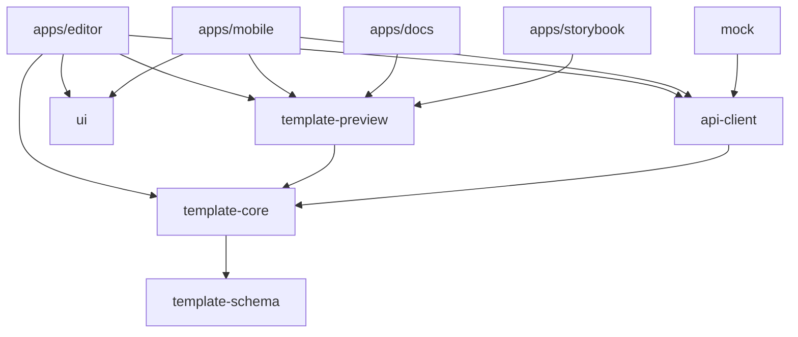

## 包职责

| 包 | 职责 | 约束 |
| --- | --- | --- |
| `@aim/template-schema` | 类型、Zod Schema、版式目录、槽位与字数、事件、参数、厂商矩阵 | 纯数据，不依赖 React / DOM |
| `@aim/template-core` | 文档操作、插件注册、版式蓝图、预检、三信融合转换、旧数据适配、分享链接 | 纯函数，可在 Node / Worker 运行 |
| `@aim/template-preview` | React 渲染器、手机壳、厂商主题、多协议、iframe、Web Component | 自带 `styles.css`，不依赖 Tailwind |
| `@aim/ui` | shadcn/ui + Radix 企业组件、移动端组件 | Tailwind v4 token |
| `@aim/api-client` | 接口契约、请求层、TanStack Query hooks | 业务只依赖契约 |
| `@aim/mock` | MSW handlers、示例模板、IndexedDB 持久化 | 仅开发 / 测试使用 |
| `@aim/utils` | HTML 净化、格式化、存储、编码、校验 | 无业务依赖 |
| `@aim/ai-kit` | 提示词、规则与规范文档生成 | 由 schema 生成 |
| `tooling/*` | tsconfig、eslint、tailwind token、vitest 配置 | – |

## 源码引用与发布

- 工作区内包的 `exports` 指向 `src/*.ts`，应用通过 `transpilePackages` 直接编译源码，修改即时生效；
- 发布时 `publishConfig.exports` 指向 tsup 产物（ESM + `.d.ts`）；
- `@aim/template-schema`、`@aim/template-core`、`@aim/template-preview` 为 Changesets linked 组，保证协议版本一致。

## 数据流（编辑器）

1. 选择版式 → `createDocument` 由蓝图生成元素；
2. 编辑 → Zustand 状态（zundo 撤销栈，连续输入合并）→ `syncParams` 自动登记参数；
3. 每次修改实时 `precheck` → 质量分、画布问题标记；
4. 1.5 秒防抖自动保存；
5. 提交 → `convertDocument` 生成 RCS / RMS → `submitTemplate`。
