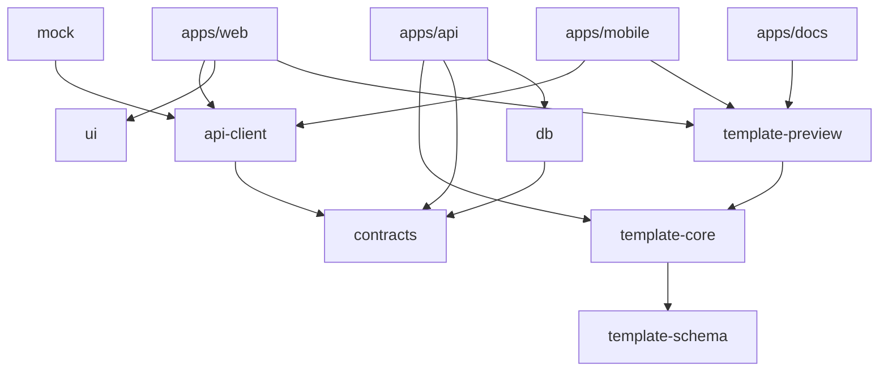

## 包职责

| 包                      | 职责                                                          | 约束                                    |
| ----------------------- | ------------------------------------------------------------- | --------------------------------------- |
| `@aim/template-schema`  | 类型、Zod Schema、版式目录、槽位与字数、事件、参数、厂商矩阵  | 纯数据，不依赖 React、DOM、数据库或账号 |
| `@aim/template-core`    | 文档操作、插件注册、版式蓝图、预检、三信融合转换、旧数据适配  | 纯函数，可在 Node / Worker 运行         |
| `@aim/template-preview` | React 渲染器、手机壳、厂商主题、多协议、iframe、Web Component | 自带 `styles.css`，不依赖 Tailwind      |
| `@aim/api-contracts`    | 请求模型、错误码、分页和权限标识                              | 不依赖数据库或 React                    |
| `@aim/db`               | Drizzle 表结构、连接、迁移和种子                              | 仅服务端引用                            |
| `@aim/api-client`       | 会话、上传和业务请求入口                                      | 应用不直接 fetch 业务接口               |
| `@aim/i18n`             | 中英文词典与语言类型                                          | 模板正文不自动翻译                      |
| `@aim/ui`               | shadcn/ui + Radix 企业组件、移动端组件                        | Tailwind v4 token                       |
| `@aim/mock`             | MSW handlers 与示例模板                                       | 仅组件开发、测试和显式演示              |
| `@aim/utils`            | HTML 净化、格式化、编码、校验                                 | 无业务依赖                              |
| `@aim/ai-kit`           | 提示词、规则与规范文档生成                                    | 由 schema 生成                          |

## 源码引用与发布

- 工作区内包的 `exports` 指向 `src/*.ts`，应用通过 `transpilePackages` 直接编译源码，修改即时生效；
- 发布时 `publishConfig.exports` 指向 tsup 产物（ESM + `.d.ts`）；
- `@aim/template-schema`、`@aim/template-core`、`@aim/template-preview` 为 Changesets linked 组，保证协议版本一致。

## 数据流

1. 注册并验证邮箱后创建或加入工作空间；服务端用会话确认成员和角色。
2. 选择版式 → `createDocument` 由蓝图生成元素，草稿属于当前工作空间。
3. 编辑 → Zustand 状态（zundo 撤销栈）→ `syncParams` 登记参数；保存请求携带 `revision`，冲突返回 409。
4. 每次修改在客户端做实时 `precheck`；提交时服务端重新校验、净化和转换，并写入不可变版本快照。
5. 审核通过后单独发布。已发布版本不被后续草稿覆盖；移动体验只读取已发布版本。
