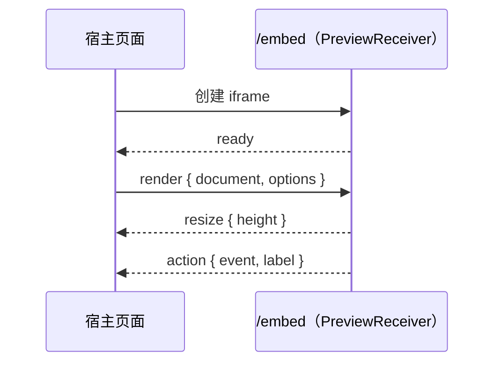

## 原理



## 宿主端

宿主脚本零依赖，提供 ESM 与 IIFE（全局 `AimPreviewEmbed`）两种产物：

```ts
import { createPreviewEmbed } from '@aim/template-preview/embed'

const embed = createPreviewEmbed({
  container: document.getElementById('preview'),
  src: 'https://m.example.com/embed',
  document: tpl,
  options: { vendor: 'huawei', mode: 'fluid', paramDisplay: 'example' },
  onAction: ({ event }) => console.log(event),
})

embed.update(nextTpl)              // 更新模板
embed.setOptions({ vendor: 'vivo' }) // 切换厂商
embed.updateLegacy({ pages, cardId })
embed.destroy()
```

```html
<!-- 不使用打包工具 -->
<script src="https://cdn.example.com/aim-preview/embed/host.global.js"></script>
<script>
  AimPreviewEmbed.createPreviewEmbed({ container: el, src: '/embed', document: tpl })
</script>
```

## 接收端

`apps/mobile` 已提供 `/embed` 页面。其他项目可自行挂载：

```tsx
import { PreviewReceiver } from '@aim/template-preview/embed/receiver'

export default function EmbedPage() {
  return <PreviewReceiver allowOrigins={['https://admin.example.com']} />
}
```

`allowOrigins` 用于限制可发送模板的宿主来源；接收端只渲染，不执行敏感操作。
